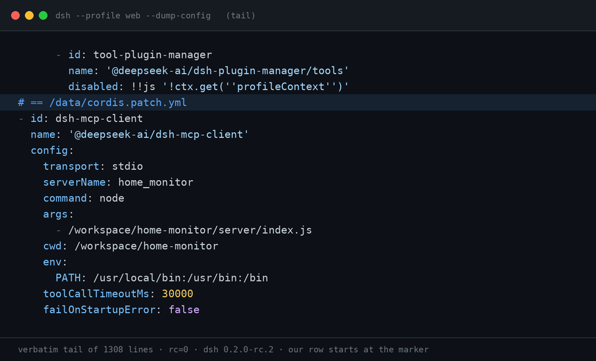
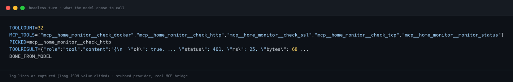
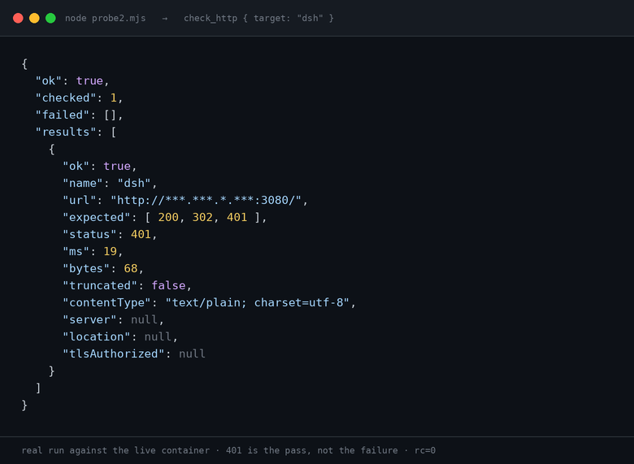

# home-monitor

**Built for dsh 0.2.0-rc.2. Also runs standalone as an MCP stdio server.**

Read-only health checks for a small self-hosted setup, packaged two ways:

1. **A DSH plugin** — five tools registered straight into the agent (`monitor_http`, `monitor_tcp`, `monitor_ssl`, `monitor_docker`, `monitor_targets`).
2. **A standalone MCP stdio server** — the same checks behind `check_http`, `check_tcp`, `check_ssl`, `check_docker`, `monitor_status`, usable from any MCP client.

Both read the same `server/config.json`, so the inventory of things to watch lives in one file.

Nothing here writes, restarts, or "fixes" anything. Every check opens a socket, reads, and closes it.

## What it looks like

Every image below is a capture of real output, not a mock-up. The capture scripts live in `docs/_capture/`; they are dev helpers and are not part of the shipped package.

**1. The patch row lands in the config the server actually loads.** Tail of `dsh --profile web --dump-config` (1308 lines, rc=0); our row starts at the marked line and is applied verbatim.



**2. The model picks the MCP tool by itself.** The provider is stubbed so the run is reproducible; the MCP bridge, the five-tool list and the `401` behind `TOOLRESULT` are real.



**3. One real probe against the live container.** `401` on `/` is the pass, not the failure — that is the auth gate answering.



---

## Layout

```
home-monitor/
├── package.json            plugin manifest (dsh.bundle.patch → cordis.patch.yml)
├── cordis.patch.yml        patch row that wires the MCP server into DSH
├── lib/index.js            DSH plugin: registers the five tools
└── server/
    ├── package.json        separate package — owns the MCP SDK dependency
    ├── config.json         the whole inventory: http / tcp / ssl / docker
    ├── index.js            MCP stdio server
    └── monitors/
        ├── http.js         status code + latency + body size
        ├── tcp.js          connect / close
        ├── ssl.js          expiry, days left, issuer, chain trust
        └── docker.js       engine ping + per-container state
```

`server/` is its own package on purpose: it has exactly one dependency
(`@modelcontextprotocol/sdk`), and the plugin layer does not depend on it at all —
`lib/index.js` imports the monitor modules directly, so a broken MCP link never
takes the DSH tools down with it.

---

## Prerequisites inside the DSH container

Exactly **one** bare name has to be made resolvable by hand. Everything else
ships with the image. Checked against `dsh 0.2.0-rc.2`.

- **`@deepseek-ai/dsh-tools` — required.** `lib/index.js` imports `defineTool`
  from it by bare name. `package.json` lists it only as an *optional* peer
  dependency, so `npm i` will not fetch it, and Node's upward walk from
  `/workspace/home-monitor/lib/` cannot reach dsh's nested tree. In the stock
  image it sits at
  `/usr/local/lib/node_modules/@deepseek-ai/dsh/node_modules/@deepseek-ai/dsh-tools`.
  Link it next to the plugin:

```sh
mkdir -p /workspace/home-monitor/node_modules/@deepseek-ai
ln -sfn /usr/local/lib/node_modules/@deepseek-ai/dsh/node_modules/@deepseek-ai/dsh-tools \
        /workspace/home-monitor/node_modules/@deepseek-ai/dsh-tools
```

  If you would rather not keep a foreign symlink inside the package, make it a
  real `file:` dependency in `package.json` and reinstall — same effect, more
  moving parts.

- **`@deepseek-ai/dsh-mcp-client` — nothing to do.** It is a declared dependency
  of the `dsh` package itself (one of 82), and the plugin loader resolves patch
  rows with `createRequire(import.meta.url)` from
  `.../dsh/node_modules/@deepseek-ai/cordis-plugin-loader/lib/index.js` — that
  is, straight into `.../dsh/node_modules/`. Verified on a stock image: the row
  loads with no extra links anywhere, `/usr/local/lib/node_modules/@deepseek-ai/`
  holding only `dsh` and `/data/profiles/web/` having no `node_modules` at all.

  Linking it beside `dsh-tools` is harmless and makes ad-hoc resolution checks
  from the plugin directory pass; it is not required for the row to load.

```sh
ln -sfn /usr/local/lib/node_modules/@deepseek-ai/dsh/node_modules/@deepseek-ai/dsh-mcp-client \
        /workspace/home-monitor/node_modules/@deepseek-ai/dsh-mcp-client   # optional
```

Pointing the row at the nested directory as `file:///usr/local/lib/…/dsh-mcp-client`
does **not** work: the loader wants a package entry (`exports['.'] → ./lib/index.js`),
and a nested absolute path is not an install layout it accepts. Name the package
and let resolution do the rest.

Check resolution the way the loader does it — from dsh's own package directory.
Resolving from `/data/profiles/web` throws `MODULE_NOT_FOUND` **even on a working
install** (that directory has no `node_modules`), so it proves nothing:

```sh
docker exec dsh sh -c 'cd /usr/local/lib/node_modules/@deepseek-ai/dsh && node -e "console.log(require.resolve(\"@deepseek-ai/dsh-mcp-client\"))"'
```

The functional check, after a restart, is the row showing up in the merged
config plus the tools appearing:

```sh
docker exec dsh dsh --profile web --dump-config | grep -n 'home-monitor\|mcp-client'
# then: the harness should expose mcp__home_monitor__check_http
```

---

## Quick start (DSH plugin)

Get the code:

```sh
git clone https://github.com/lowspecai/dsh-home-monitor.git
```

The default install path in the patches below assumes the source lives at
`/workspace/home-monitor` inside the DSH container (`./workspace` on the host).

```sh
# 1. dependencies for the MCP server
cd /workspace/home-monitor/server && npm i

# 2. make the plugin resolvable from the profile directory
#    (see "Wiring" below — pick A or C)

# 3. restart and look for the tools
#    DSH's HMR root is empty in the stock config, so a restart is the reload.
docker restart dsh && docker logs --tail 40 dsh
```

### Rebuilding from scratch in a fresh container

```sh
# copy the package in (from the host, where ./workspace is mounted)
docker cp home-monitor dsh:/workspace/home-monitor

# MCP server dependency — 95 packages, ~10 s on a domestic mirror
docker exec dsh sh -c 'cd /workspace/home-monitor/server && npm i'

# the one bare-name symlink from "Prerequisites" (dsh-mcp-client needs none)
docker exec dsh sh -c 'mkdir -p /workspace/home-monitor/node_modules/@deepseek-ai && ln -sfn /usr/local/lib/node_modules/@deepseek-ai/dsh/node_modules/@deepseek-ai/dsh-tools /workspace/home-monitor/node_modules/@deepseek-ai/dsh-tools'

# confirm both halves before touching the live config
docker exec dsh dsh --profile web --dump-config | grep -n 'home-monitor\|mcp-client'
```

`npm i` needs a registry that answers from inside the container. The image
defaults to npmmirror; `npm config get registry` tells you what you are on.
Set `npm_config_registry` if you are rebuilding somewhere else.

Verify the plugin *before* restarting the live container, using a throwaway
overlay so a broken row cannot restart-loop production:

```sh
# /tmp/ol.yml
- insert:
    - id: home-monitor
      name: '/workspace/home-monitor/lib/index.js'
```

```sh
docker exec dsh sh -c 'cd /workspace && dsh --profile headless --patch /tmp/ol.yml \
  --dump-config' | grep -n home-monitor
```

`--profile` is required even when you pass `--patch`; the overlay is applied
after the profile, so it cannot be shadowed by it.

### Wiring, option A — install into the profile

```sh
docker exec dsh sh -c 'cd /data/profiles/web && corepack enable pnpm && pnpm add /workspace/home-monitor'
```

Then add one row to `/data/profiles/web/cordis.patch.yml`:

```yaml
- insert:
    - id: home-monitor
      name: home-monitor
```

### Wiring, option C — point the profile at the source directory

No pnpm, no `node_modules` — just an absolute-ish path the profile can resolve:

```yaml
- insert:
    - id: home-monitor
      name: '/workspace/home-monitor/lib/index.js'
```

Both rows go in the **profile** patch (or the home patch, or a `--patch`
overlay — order only matters for conflicts, see below). Back up
`cordis.patch.yml` before editing it; a syntactically valid but schema-invalid
row will restart-loop the container.

### Verify without booting

```sh
docker exec dsh dsh --profile web --dump-config | grep -n 'home-monitor'
```

Each applied patch file is echoed at the end of the dump under `# == <path>`, so
you can see which layer contributed the row.

---

## `server/config.json`

JSON on purpose — the server parses it with `JSON.parse`, so there is no YAML
dependency and no extra failure mode. Keys starting with `_` are documentation
and are ignored by the code.

| Key | Meaning |
|---|---|
| `http.timeoutMs` | Per-request timeout, default 8000 |
| `http.targets[]` | `{ name, url, expect?, headers? }` — `expect` is a code or an array of codes; `[200, 302, 401]` means "any of these is healthy" |
| `tcp.timeoutMs` | Connect timeout, default 5000 |
| `tcp.targets[]` | `{ name, host, port }` |
| `ssl.timeoutMs` | Handshake timeout, default 10000 |
| `ssl.warnDays` | Global expiry warning window, default 21 |
| `ssl.targets[]` | `{ name, host, port?, warnDays?, servername?, allowSelfSigned? }` |
| `docker.enabled` | **Default false.** When false the tool returns `status: "unavailable"` instead of an error |
| `docker.socket` | Default `/var/run/docker.sock` |
| `docker.expectRunning[]` | Container names that must be in state `running` |

`targets[].name` is the handle you pass as `{ "target": "name" }`. Omit the
argument to check everything in that group.

### Why `expect` takes an array

Auth-protected endpoints are healthy when they say 401. Pinning `200` alone
turns "the service is up and correctly refusing anonymous requests" into a false
alarm, which is the fastest way to make a monitor untrustworthy.

### Why Docker is off by default

Mounting the Docker socket into an agent is a privilege escalation. It is opt-in
so that a copied config never hands out more than it says on the tin.

---

## Standalone MCP server

```sh
cd server && npm i
node index.js        # speaks JSON-RPC over stdio, logs to stderr only
```

Register it in any MCP client:

```json
{
  "mcpServers": {
    "home_monitor": {
      "command": "node",
      "args": ["/workspace/home-monitor/server/index.js"],
      "env": { "PATH": "/usr/local/bin:/usr/bin:/bin" }
    }
  }
}
```

If you wire it through `@deepseek-ai/dsh-mcp-client` instead, note that
**`env` is scrubbed unless you pass it explicitly** — leave it out and `node`
will not be on PATH. `serverName` must match `[A-Za-z0-9_-]{1,32}`.

### One smoke test, no client needed

```sh
printf '%s\n' \
  '{"jsonrpc":"2.0","id":1,"method":"initialize","params":{"protocolVersion":"2025-06-18","capabilities":{},"clientInfo":{"name":"t","version":"0"}}}' \
  '{"jsonrpc":"2.0","method":"notifications/initialized"}' \
  '{"jsonrpc":"2.0","id":2,"method":"tools/list"}' \
  | node index.js
```

---

## Result shape

Every tool returns one JSON object. Failures are values, not exceptions:

```json
{ "ok": false, "checked": 3, "failed": ["hermes-api"], "results": [ ... ] }
```

- `ok` — false if any check in the batch failed
- `failed` — names only, so a caller can act without parsing the details
- `results[]` — one entry per target, each with `name`, `ok`, `ms`, plus
  protocol-specific evidence (status code, certificate dates, container states)
- Unknown target name → `ok: false, error: "unknown target …", known: [...]`

`check_docker` / `monitor_docker` returns a single object rather than a batch,
because there is only ever one Docker socket.

---

## Patch layering (for when a row does not take effect)

Later layers win, per row, matched by `id`:

```
bundle patches → profile → $DSH_HOME/cordis.patch.yml → --patch overlays
```

Two consequences worth remembering:

- **`config` is replaced wholesale.** If you override a row to change one
  field, restate the rest, or schema validation fails and the container
  restart-loops.
- **Row order carries no loading semantics.** Moving a row up or down in the
  file changes nothing.

Debug ordering with `dsh --profile web --dump-config | tail -60`: applied
patches are listed under `# == <path>` markers in application order.

---

## Security

- Read-only by construction: `GET` requests, TCP connects, TLS handshakes, and
  Docker `GET` endpoints. No writes, no restarts, no shell.
- There is **no outbound address filter** — the whole point is checking private
  addresses. Treat `config.json` as trusted input, and never expose this server
  or its socket to an untrusted network.
- `ssl` checks connect with `rejectUnauthorized: false` so it can *report* an
  untrusted chain instead of crashing on it. Trust is a value in the result
  (`authorized`), and `allowSelfSigned: true` is what decides whether an
  untrusted chain counts as a problem.
- Do not mount the Docker socket unless `docker.enabled` is true.

## Known limits

- No auto-reconnect at the MCP layer; if the child process dies, restart it.
- `timeoutMs` inside DSH only honours itself when the tool-call-timeout policy
  plugin is loaded. The plugin here also races every call against a hard
  20-second deadline so a hung check cannot wedge a turn.
- Tool discovery is snapshotted at startup — edit `config.json` and restart.
- **The container has no `ps`.** To see whether the MCP child exists, read
  `/proc/<pid>/status` (`Name:`, `PPid:`), or list children from PID 1:

  ```sh
  docker exec dsh sh -c 'cat /proc/1/task/1/children'
  docker exec dsh sh -c 'grep -H "^PPid:" /proc/[0-9]*/status | grep -w 1'
  docker top dsh
  ```

  From the host, `docker top dsh` is the least error-prone of the four.
- **Occasionally the stdio child survives the turn that started it.** In one
  observed case the `node /workspace/home-monitor/server/index.js` process was
  reparented to PID 1 and stayed there: `PPid: 1`, `wchan: do_epoll_wait`,
  sockets on fd 0 and 1, the only entry in `/proc/1/task/1/children`, started
  ~452 s after the container booted. The same probe run twice more tore the
  child down normally, so this is an intermittent teardown race in the MCP
  client, **not** a wiring problem — tool calls still worked while it lingered.
  If you find a stale child, kill it yourself:

  ```sh
  docker exec dsh sh -c 'kill $(cat /proc/1/task/1/children)'
  ```

  Check the command line first (`cat /proc/<pid>/cmdline | tr "\0" " "`) so you
  do not kill something else PID 1 happened to inherit.
